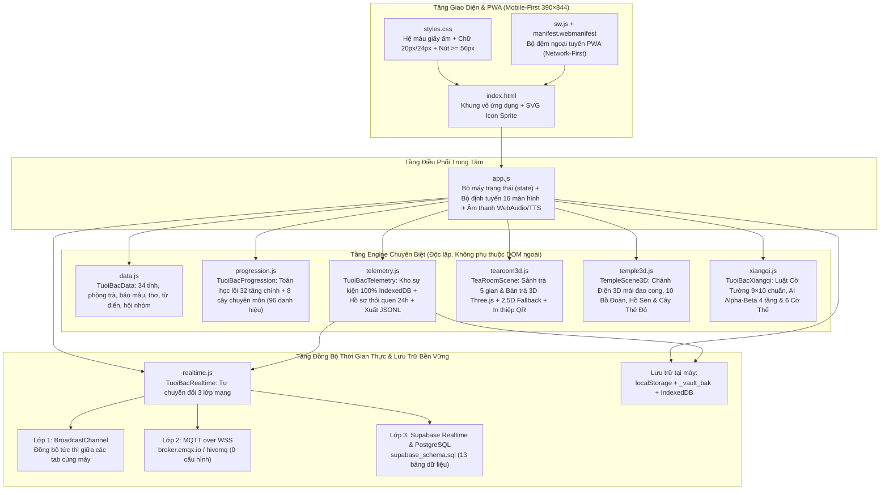

# ARCHITECTURE.md — Tổng Kiến Trúc Hệ Thống Game Tuổi Bạc

Tài liệu này là bản đồ kỹ thuật trung tâm của dự án **Tuổi Bạc**. Mọi lập trình viên hoặc AI Agent khi tiếp nhận dự án dùng tệp này để nắm bắt luồng dữ liệu, ranh giới giữa các tệp mã nguồn và vị trí chính xác của từng màn hình chức năng.

---

## 1. Sơ Đồ Kiến Trúc Tổng Thể (Layered Game Architecture)

---

## 2. Danh Mục Toàn Bộ Tệp Mã Nguồn Tại Thư Mục Gốc

> **Quy tắc kiểm tra tự động:** Trình kiểm định `scripts/studio-doctor.mjs` đối chiếu danh sách tệp `.js` thực tế trên đĩa với bảng dưới đây. Nếu thêm tệp `.js` mới mà chưa khai báo vào bảng này, cổng kiểm định sẽ báo lỗi ngay lập tức.

| Thứ tự nạp | Tên tệp | Namespace toàn cục | Trách nhiệm kỹ thuật cốt lõi |
| :---: | :--- | :--- | :--- |
| — | `index.html` | DOM Shell | Khung trang đơn (SPA), kho biểu tượng `<svg class="svg-sprite">`, thanh trạng thái hội viên, hộp thoại `<dialog>` dùng chung và nạp thư viện CDN (`Three.js r160`, `qrcode-generator`, `mqtt.js 5`, `supabase-js 2`). |
| — | `styles.css` | CSS Tokens | Toàn bộ biến màu `--bg-paper`, quy chuẩn chữ lớn cho người cao tuổi, bố cục thẻ, bàn cờ, sảnh 3D, biểu đồ 24h và chế độ `.xl-font`. |
| 1 | `data.js` | `window.TuoiBacData` | Kho dữ liệu tĩnh: danh mục 34 đơn vị hành chính Việt Nam mới (kèm tỉnh cũ gộp vào), mẫu câu gợi ý theo chủ đề (`REPLY_MATRIX`), từ điển phát âm vùng miền (`INITIAL_PHONETIC_DICT`), 5 phòng trà, bài báo mẫu, câu đố vui, bài thơ, 8 Sticker văn hóa trà, thẻ an lạc và đơn vị đồng ngũ mẫu (`Đại đội 1K2 · D3 · Sư đoàn 25`). |
| 2 | `progression.js` | `window.TuoiBacProgression` | Hệ thống toán học tính điểm thăng cấp lồi: 32 tầng thâm niên chính thức chia làm 6 giai đoạn (`ERAS`) và 8 cây kỹ năng chuyên sâu (`SKILL_TREES`, tổng 96 danh hiệu), kèm hàm phân loại nhãn Người mới / Quen thân / Tri kỷ / Trưởng lão / Cây đại thụ. |
| 3 | `telemetry.js` | `window.TuoiBacTelemetry` | Động cơ ghi nhận 100% hành vi thành viên vào `IndexedDB` (`tuoibac_telemetry_db_v1`), tổng hợp ma trận hoạt động 24 giờ, thời lượng lưu màn hình (`dwellSec`), phân rã 4 phương thức chat và xuất dữ liệu huấn luyện AI (`.jsonl`, `.json`, `.csv`). |
| 4 | `tearoom3d.js` | `window.TeaRoomScene` | Đồ họa 3D Three.js cho Sảnh trà 5 gian góc rộng hình chữ U (6 bàn), cận cảnh bàn trà tròn 5 ghế, ấm trà bốc khói, nhân vật 3D mặc trang phục/khung danh hiệu, bong bóng Sticker nổi, chế độ 2.5D tĩnh dự phòng và bộ vẽ thiệp mời / mã QR ra ảnh PNG. |
| 5 | `temple3d.js` | `window.TempleScene3D` | Đồ họa 3D Three.js cho Chánh Điện & Sân Chùa Cổ: mái ngói 2 tầng đao cong, tượng Phật đài sen, lư hương khói trầm, Đại Hồng Chung đung đưa, Mõ gỗ nảy nhịp, 10 chiếu Bồ Đoàn 3D ngồi chung, sân Hồ Sen thả hoa đăng và Cây Ước Nguyện treo thẻ đỏ. |
| 6 | `xiangqi.js` | `window.TuoiBacXiangqi` | Engine Cờ Tướng `9×10` chuẩn 32 quân hoàn chỉnh: sinh nước đi hợp lệ cho cả 7 binh chủng, luật tướng đối mặt, kiểm tra tự chiếu/chiếu bí, AI đối thủ câu lạc bộ (Minimax + Alpha-Beta Pruning + Bảng điểm vị trí PST + Sắp xếp nước bắt quân MVV-LVA) và 6 ván Cờ Thế cổ phổ. |
| 7 | `realtime.js` | `window.TuoiBacRealtime` | Lớp mạng thời gian thực tự phục hồi: kết nối song song `BroadcastChannel` nội bộ và `MQTT over WSS` công cộng (hoặc `Supabase` khi cấu hình khóa), quản lý hiện diện trực tuyến theo bàn và toàn quán, hàng đợi chat, ván cờ treo, thẻ hội viên đám mây, hội nhóm, kết bạn, chánh điện và luồng telemetry. |
| 8 | `app.js` | IIFE Controller | Bộ điều phối trung tâm gắn kết tất cả module: quản lý `state`, lưu trữ kép (`localStorage` + `_vault_bak`), bộ định tuyến `navigate(route)`, xử lý Deep Link URL, tổng hợp giọng đọc tiếng Việt (Web Speech TTS + dự phòng luồng âm thanh), nhận dạng giọng nói kèm tự học từ điển phương ngữ, âm thanh nhạc cụ WebAudio (chuông chùa, mõ gỗ, quân cờ, đàn tranh) và 16 hàm dựng màn hình. |
| 9 | `sw.js` | Service Worker | Quản lý bộ nhớ đệm PWA (`tuoibac-pwa-v15`): chiến lược *Network-First* cho mã nguồn chính để luôn nhận bản mới nhất khi có mạng và tự động dùng bản lưu sẵn khi mất sóng 4G, đồng thời bỏ qua không chặn các luồng WebSocket/TTS/RSS. |
| — | `supabase_schema.sql` | PostgreSQL DDL | Tập lệnh SQL khởi tạo 14 bảng dữ liệu và chính sách bảo mật RLS trên gói miễn phí Supabase. |

---

## 3. Bản Đồ Định Vị 16 Màn Hình (`route`) Trong `app.js`

Khi cần sửa giao diện hoặc logic của một màn hình cụ thể, tra cột **Hàm dựng chính** dưới đây để nhảy thẳng tới đúng vị trí trong `app.js`:

| Giá trị `state.route` | Tên màn hình trên giao diện | Hàm dựng chính trong `app.js` | Module phối hợp |
| :--- | :--- | :--- | :--- |
| `"home"` | Trang chủ Quán Trà (Chế độ Đầy đủ & Chuẩn MVP 3 nút) | `renderHome()` | `progression.js`, `realtime.js` |
| `"checkin"` | Điểm danh bình an buổi sáng & Bản đồ 34 tỉnh thành | `renderCheckin()` | `data.js`, `tearoom3d.js` (xuất thiệp QR), `realtime.js` |
| `"tearoom"` | Quán Trà 3D (Sảnh 5 gian 6 bàn & Trong bàn trà đàm đạo) | `renderTeaRoom()`, `renderTeaRoomLobby()`, `renderTeaRoomTableView()` | `tearoom3d.js`, `xiangqi.js` (khi vào Phòng Cờ), `realtime.js`, `telemetry.js` |
| `"newspaper"` | Tờ Báo Sáng Quán Trà (Tìm kiếm chủ đề, nghe đọc báo, mở bàn đàm đạo theo tin) | `renderNewspaper()`, `openArticleDetailModal()` | `data.js`, `telemetry.js` |
| `"groups"` | Hội Đồng Ngũ, Câu Lạc Bộ & Kết Bạn Đang Online | `renderGroupsAndFriends()`, `openCreateGroupModal()` | `data.js`, `realtime.js`, `openMemberAuthModal()` |
| `"xiangqi"` | Cờ Tướng Chuẩn `9×10` (32 quân) & Giải 6 Cờ Thế Cổ Phổ | `renderXiangqiScreen()`, `renderXiangqiTab()` | `xiangqi.js`, `realtime.js` (ván treo qua link) |
| `"games"` | Ô Ăn Quan Dân Gian (Đấu Máy & Ván Treo Mời Bạn) | `renderGames()`, `renderOaqTab()` | `realtime.js`, `telemetry.js` |
| `"quiz"` | Đố Vui Minh Mẫn Hôm Nay (5 câu, không phạt người chậm) | `renderQuiz()` | `data.js`, `telemetry.js` |
| `"poetry"` | Chiếu Thơ Lục Bát, Đàn Tranh & Sáng Tác Thơ Mới | `renderPoetry()` | `data.js`, `realtime.js` |
| `"watch"` | Phòng Xem Chung Theo Giờ Hẹn (Dưỡng sinh & Hài kịch phụ đề lớn) | `renderWatch()` | `data.js` |
| `"zen"` | Chánh Điện 3D & Sân Chùa Cổ (10 Bồ Đoàn, Hồ Sen, Cây Thẻ Đỏ) | `renderZen()` | `temple3d.js`, `realtime.js`, `telemetry.js` |
| `"leaderboard"` | Hệ Thống 96 Danh Hiệu Toán Học & Bảng Vàng Mới – Cũ | `renderLeaderboard()` | `progression.js` |
| `"profile"` | Hồ Sơ Cá Nhân, Tủ Trang Phục & Khung Danh Hiệu 3D | `renderProfile()` | `tearoom3d.js` (sân khấu thử đồ 3D), `progression.js` |
| `"health"` | Trợ Lý Sức Khỏe, Nhắc Thuốc & Nút Cấp Cứu 115 | `renderHealth()` | `data.js` |
| `"family"` | Góc Con Cái Theo Dõi Bình An Từ Xa | `renderFamilyView()` | `tearoom3d.js` (QR liên kết gia đình) |
| `"privacy"` | Kho AI Tracking 100% (`IndexedDB`) & Quyền Riêng Tư (NĐ 13/2023) | `renderPrivacyAndMetrics()` | `telemetry.js`, `realtime.js` |

---

## 4. Vòng Đời Khởi Động & Các Bộ Đếm Thời Gian Ngầm

### 4.1. Luồng khởi động ứng dụng (Boot Sequence)
1. Trình duyệt tải `index.html`, dựng cây DOM tĩnh và nạp tuần tự 9 tệp `.js` có thuộc tính `defer`.
2. `telemetry.js` mở kết nối bất đồng bộ tới cơ sở dữ liệu `IndexedDB` (`tuoibac_telemetry_db_v1`) và nạp ma trận thói quen nóng.
3. `app.js` khởi tạo `state = loadState()` (đọc từ `STORAGE_KEY`, tự động rơi về bản sao `_vault_bak` nếu JSON lỗi, rồi hợp nhất sâu với `createDefaultState()`).
4. `applyUrlDeepLinkIfPresent()` kiểm tra thanh địa chỉ URL để xử lý ngay các liên kết mời bạn (`?phong=&ban=`, `?van=`, `?tin=`, `?tinh=`, `?ketban=`, `?hoi=`, `?khoiphuc=`, `?may=`).
5. `RT.start()` mở kênh `BroadcastChannel` + `MQTT over WSS` (hoặc `Supabase`), sau `500ms` phát tín hiệu trực tuyến toàn cục (`syncMyGlobalOnlinePresence()`).
6. `render()` vẽ màn hình đầu tiên và đăng ký `sw.js` khi chạy qua giao thức `http/https`.

### 4.2. Sáu bộ đếm thời gian chạy ngầm (Timers & Watchdogs)
Khi gỡ lỗi liên quan đến thời gian hoặc hiệu năng, kiểm tra đúng 6 bộ đếm sau:
1. **Nhịp kiểm tra mỗi `1 giây` (`app.js`):** Tăng `sessionSeconds`, đếm thời gian im lặng trong bàn trà (`idleSec`) và kích hoạt đồng hồ nhắc nghỉ mắt.
2. **Nhịp nhấp trà `10 giây` (`cooldownTickId` trong `app.js`):** Khóa tạm nút gửi tin sau mỗi câu nói của người dùng và giãn cách hàng đợi hiển thị `5 giây/câu` (`teaQueueTimerId`) để chữ trên bảng lời bàn trà không trôi quá nhanh đối với mắt người già.
3. **Chốt thời lượng màn hình mỗi `20 giây` (`flushDwellHeartbeat` trong `app.js` → `telemetry.js`):** Cộng dồn chính xác số giây hội viên đang xem màn hình hiện tại vào kho AI Tracking.
4. **Nhịp tim hiện diện mạng mỗi `22 giây` (`HEARTBEAT_MS` trong `realtime.js`):** Phát lại trạng thái đang ngồi bàn nào / online ở đâu; tự động dọn các thiết bị mất kết nối quá `85 giây` (`PRESENCE_TTL_MS`).
5. **Trợ lý Quán Trà tự gợi chuyện sau `60 giây` im lặng (`triggerIdleAssistantPrompt` trong `app.js`):** Rót trà 3D và đưa ra câu hỏi gợi mở theo chủ đề bàn hoặc bài báo đang đọc.
6. **Nhắc nghỉ mắt sau `20 phút` (`1200 giây`, `showEyeRestModal` trong `app.js`):** Mở hộp thoại khuyên các bác nhìn xa 20 giây và uống nước ấm.
