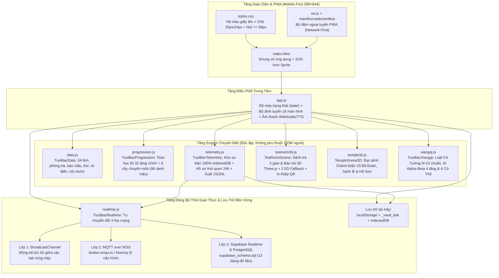

# ARCHITECTURE.md — Tổng Kiến Trúc Hệ Thống Game Tuổi Bạc

Tài liệu này là bản đồ kỹ thuật trung tâm của dự án **Tuổi Bạc**. Mọi lập trình viên hoặc AI Agent khi tiếp nhận dự án dùng tệp này để nắm bắt luồng dữ liệu, ranh giới giữa các tệp mã nguồn và vị trí chính xác của từng màn hình chức năng.

---

## 1. Sơ Đồ Kiến Trúc Tổng Thể (Layered Game Architecture)

---

## 2. Danh Mục Toàn Bộ Tệp Mã Nguồn Tại Thư Mục Gốc

> **Quy tắc kiểm tra tự động:** Trình kiểm định `scripts/studio-doctor.mjs` đối chiếu danh sách tệp `.js` thực tế trên đĩa với bảng dưới đây. Nếu thêm tệp `.js` mới mà chưa khai báo vào bảng này, cổng kiểm định sẽ báo lỗi ngay lập tức.

| Thứ tự nạp | Tên tệp | Namespace toàn cục | Trách nhiệm kỹ thuật cốt lõi |
| :---: | :--- | :--- | :--- |
| — | `index.html` | DOM Shell | Khung trang đơn (SPA), chính sách bảo mật `Content-Security-Policy` (chặn inline script/eval XSS), thanh điều hướng đáy 4 mục chuẩn Material 3 Active Pill (`.bnav-pill` trong `bottom-nav`), kho biểu tượng `<svg class="svg-sprite">` (gồm `#ico-chart`, `#ico-feedback`, `#ico-chevron`), thanh trạng thái hội viên, hộp thoại `<dialog>` dùng chung và nạp thư viện CDN (`Three.js r160`, `qrcode-generator`, `mqtt.js 5`, `supabase-js 2`). |
| — | `styles.css` | CSS Tokens | Hệ thống thiết kế **"Mực & Chu Sa · Sáng" (Ink & Cinnabar Light · M3 Operate)**: nền giấy ngà dịu `--bg-paper: #F7F5F0`, thẻ trắng sạch `--bg-card: #FFFFFF`, mực `#1C1917`, đỏ chu sa `#B63A24`, chữ lớn `20px/24px` + font serif an toàn dấu tiếng Việt (`Merriweather`/`Cambria`/`Noto Serif`), dải Banner Chu Sa `.m3-hero-banner`, thanh đáy Active Pill `.bnav-pill`, khay chuyển tab Segmented Control `.m3-seg-bar`, hàng danh sách `.m3-list-row`, thanh chọn phòng 1 hàng `.room-strip`, nhãn nổi gọn chống che mặt `.seat-status-tag.is-compact-seat`, lưới công cụ 3 cột `.m3-tool-grid`, lưới Tủ đồ 2 cột `.catalog-grid-2`, Báo Sáng 1 hàng danh mục & chế độ `.xl-font`. |
| 1 | `data.js` | `window.TuoiBacData` | Kho dữ liệu tĩnh: danh mục 34 đơn vị hành chính Việt Nam mới (tọa độ chiếu chuẩn Natural Earth 10m `cos 16°` trên khung `380×560` + Hoàng Sa TP. Đà Nẵng, Trường Sa Khánh Hòa, Xa quê), 14 trang phục vùng miền (Bắc Ninh · Miền Trung · Miền Nam), 11 phụ kiện, 13 món đồ bày bàn trà & trà đá vỉa hè, mẫu câu gợi ý (`REPLY_MATRIX`), từ điển phát âm vùng miền (`INITIAL_PHONETIC_DICT`), 6 phòng trà (gồm `Quán Trà Đá Vỉa Hè`), bài báo mẫu, 5 bộ đố vui 25 câu (`QUIZ_PACKS`, `QUIZ_QUESTIONS`), 18 cặp ca dao tục ngữ (`PROVERB_PAIRS`), 5 CLB đối thủ Cúp Cờ Tướng (`TOURNAMENT_RIVAL_CLUBS`), gợi ý vần lục bát (`LUC_BAT_RHYME_PAIRS`), thơ, 8 Sticker trà, 6 quẻ lộc theo 3 không gian (`TEMPLE_PEACE_CARDS`), 15 tệp giọng thu sẵn (`VOICE_CLIPS`) và đơn vị đồng ngũ mẫu. |
| 2 | `progression.js` | `window.TuoiBacProgression` | Hệ thống toán học tính điểm thăng cấp lồi: 32 tầng thâm niên chính thức chia làm 6 giai đoạn (`ERAS`) và 8 cây kỹ năng chuyên sâu (`SKILL_TREES`, tổng 96 danh hiệu), kèm hàm phân loại nhãn Người mới / Quen thân / Tri kỷ / Trưởng lão / Cây đại thụ. |
| 3 | `telemetry.js` | `window.TuoiBacTelemetry` | Động cơ ghi nhận 100% hành vi thành viên vào `IndexedDB` (`tuoibac_telemetry_db_v1`), tổng hợp Dash quản lý `getGlobalActivityDashboard()`, báo cáo kiểm thử thực địa & cân chỉnh mốc `23.008 XP` (`getUatAndXpCalibrationReport()`), hồ sơ thói quen sâu và xuất dữ liệu AI (`.jsonl`, `.json`, `.csv`). |
| 4 | `tearoom3d.js` | `window.TeaRoomScene` | Bộ dựng cảnh Quán Trà chuẩn **Full 2.5D Cổ Điển (Thiên Long Bát Bộ)** với 6 bộ tranh nền Sảnh & Bàn riêng biệt cho từng không gian (`assets/tearoom-*.jpg` + `assets/room-viahe-*` / `room-tho-*` / `room-co-*` / `room-ccb-*` / `room-caycanh-*.jpg`), Sprite nhân vật `assets/tearoom-sprites.webp`, thuật toán neo nhãn nổi 2.5D không che mặt & chống đè chữ (`0%` che khuôn mặt: hàng sau neo trên chóp tóc/nón, hàng trước neo dưới đế giày kèm giải va chạm 2D), 3 bộ Sprite 11 phụ kiện 2.5D cắt sát khung bao `ACC_BBOX` + tách 2 lớp sau/trước đầu cổ dùng mặt nạ bầu dục đảo ngược `evenodd` & vòng cung trán cong (`drawSpritePreHeadAccessory` & `drawSpriteAccessories` cho Nam/Nữ/Lưng) và 3 bộ Sprite 13 món đồ bàn trà & khay trà đá vỉa hè (`tearoom-items*.webp`, `tearoom-viahe-item.webp`) đặt cân trên đôn gỗ gụ `rx=64`; giữ `dispose()` và xuất thiệp QR PNG. |
| 5 | `temple3d.js` | `window.TempleScene3D` | Không gian Tĩnh Tâm 20 Chiếu (`4×5`) tách biệt 3 bối cảnh kiến trúc riêng (`Sân Chùa Quê` `assets/temple-*.jpg`, `Nhà Thờ Họ` `assets/ancestral-*.jpg`, `Vườn Thiền Tĩnh Lặng` `assets/zengarden-*.jpg`, tự nạp ấm nền `ensureImagesLoaded`) kết hợp Sprite `assets/temple-sprites.webp`: bước lên dâng hương/gõ mõ/thỉnh chuông, thả đèn Hoa Đăng nổi trên mặt Hồ Sen 3 phút (`180s`), rút xăm/treo thẻ đỏ kèm đếm ngược hồi lượt `45s` (`28 FPS`). |
| 6 | `xiangqi.js` | `window.TuoiBacXiangqi` | Engine Cờ Tướng `9×10` chuẩn 32 quân hoàn chỉnh: sinh nước đi hợp lệ cho cả 7 binh chủng, luật tướng đối mặt, kiểm tra tự chiếu/chiếu bí, AI đối thủ câu lạc bộ (Minimax + Alpha-Beta Pruning + Bảng điểm vị trí PST + Sắp xếp nước bắt quân MVV-LVA) và 6 ván Cờ Thế cổ phổ. |
| 7 | `realtime.js` | `window.TuoiBacRealtime` | Lớp mạng thời gian thực & bền vững đã gia cố chống Prototype Pollution / OOM / gói tin lừa đảo (`safeJsonParse`, `Object.create(null)`, `capStoreKeys`, `isMaliciousNetworkText`): kết nối `BroadcastChannel` + `MQTT over WSS` công cộng hoặc `Supabase` cố định, đồng bộ hiện diện, chat, báo sáng đã duyệt, từ điển phát âm, ván cờ treo, thẻ hội viên, hội nhóm, chánh điện và luồng telemetry. |
| 8 | `app.js` | IIFE Controller | Bộ điều phối trung tâm: quản lý `state` + `_vault_bak`, tự chuyển ngày lịch mới (`ensureDailyRollover`), định tuyến 16 màn hình, Bản đồ Việt Nam chuẩn GIS Natural Earth 10m (290 đỉnh đất liền + 21 đảo ven bờ + sao vàng Thủ đô Hà Nội + thước tỷ lệ `0–200 km` + Vịnh Bắc Bộ / Biển Đông / Hoàng Sa / Trường Sa), Sổ tay 3 niềm vui hôm nay, AI Ô ăn quan + Lật thẻ Ca dao trí nhớ, Cúp Cờ Tướng Đồng Ngũ 3 vòng, In thiệp lụa bài thơ PNG, Sân khấu Phòng xem chung 24 FPS, Sổ nước ấm & huyết áp, khóa mật khẩu Admin chống dò (`5` lần sai khóa `60s` + băm lặp `2.500` vòng), bộ lọc an toàn 2 lượt chống lừa đảo/XSS, hiệu ứng mở tờ giấy đỏ xem quẻ (`45s`) và giọng đọc tiếng Việt. |
| 9 | `sw.js` | Service Worker | Quản lý bộ nhớ đệm PWA (`tuoibac-pwa-v32`): chiến lược *Network-First* cho mã nguồn chính để luôn nhận bản mới nhất khi có mạng và tự động dùng bản lưu sẵn khi mất sóng 4G (bao gồm ảnh nền 6 phòng trà `room-*`, 3 không gian tĩnh tâm, trọn bộ Sprite Quán Trà `tearoom-*` và 15 tệp âm thanh `assets/audio/*.mp3`), đồng thời bỏ qua không chặn các luồng WebSocket/TTS/RSS. |
| — | `supabase_schema.sql` | PostgreSQL DDL | Tập lệnh SQL khởi tạo 14 bảng dữ liệu và chính sách bảo mật RLS tối thiểu đặc quyền (chặn `DELETE` ẩn danh, bảng `safety_reports` chỉ cho phép `INSERT` ẩn danh kèm ràng buộc `char_length`; đi kèm mẫu lịch tự động `docs/workflows/morning-rss.yml`, `scripts/fetch-morning-rss.mjs` và `scripts/e2e-regression.mjs`). |

---

## 3. Bản Đồ Định Vị 16 Màn Hình (`route`) Trong `app.js`

Khi cần sửa giao diện hoặc logic của một màn hình cụ thể, tra cột **Hàm dựng chính** dưới đây để nhảy thẳng tới đúng vị trí trong `app.js`:

| Giá trị `state.route` | Tên màn hình trên giao diện | Hàm dựng chính trong `app.js` | Module phối hợp |
| :--- | :--- | :--- | :--- |
| `"home"` | Trang chủ Quán Trà (Chế độ Đầy đủ, Sổ tay 3 niềm vui hôm nay & Chuẩn MVP 3 nút) | `renderHome()` | `progression.js`, `realtime.js` |
| `"checkin"` | Điểm danh bình an buổi sáng & Bản đồ địa lý chữ S 34 tỉnh thành (`380×560`, đảo ven bờ, Hoàng Sa, Trường Sa, Xa quê) | `renderCheckin()` | `data.js`, `tearoom3d.js` (xuất thiệp QR), `realtime.js` |
| `"tearoom"` | Quán Trà 3D (Sảnh 5 gian 6 bàn & Trong bàn trà đàm đạo) | `renderTeaRoom()`, `renderTeaRoomLobby()`, `renderTeaRoomTableView()` | `tearoom3d.js`, `xiangqi.js` (khi vào Phòng Cờ), `realtime.js`, `telemetry.js` |
| `"newspaper"` | Tờ Báo Sáng Quán Trà (Tìm kiếm chủ đề, nghe đọc báo, mở bàn đàm đạo theo tin) | `renderNewspaper()`, `openArticleDetailModal()` | `data.js`, `telemetry.js` |
| `"groups"` | Hội Đồng Ngũ, Câu Lạc Bộ, Đấu Cúp Đơn Vị & Kết Bạn Đang Online | `renderGroupsAndFriends()`, `openCreateGroupModal()` | `data.js`, `realtime.js`, `openMemberAuthModal()` |
| `"xiangqi"` | Cờ Tướng Chuẩn `9×10` (32 quân), Cúp Đồng Ngũ 3 Vòng & Giải 6 Cờ Thế Cổ Phổ | `renderXiangqiScreen()`, `renderXiangqiTab()` | `xiangqi.js`, `realtime.js` (ván treo qua link) |
| `"games"` | Ô Ăn Quan (AI Cao Thủ Làng + Gợi Ý), Cờ Tướng & Lật Thẻ Ca Dao Trí Nhớ | `renderGames()`, `renderOaqTab()`, `renderProverbMemoryTab()` | `data.js`, `realtime.js`, `telemetry.js` |
| `"quiz"` | Đố Vui Minh Mẫn Hôm Nay (5 bộ × 5 câu = 25 câu, trợ giúp 50/50) | `renderQuiz()` | `data.js`, `telemetry.js` |
| `"poetry"` | Chiếu Thơ Lục Bát, Gợi Ý Vần 6–8, Đàn Tranh & In Thiệp Lụa PNG | `renderPoetry()`, `exportPoemSilkPostcardPng()` | `data.js`, `tearoom3d.js` (QR), `realtime.js` |
| `"watch"` | Phòng Xem Chung (Sân khấu Canvas 24 FPS: Hoa sen nhịp thở, Chiếu chèo, Quê chiều) | `renderWatch()`, `mountWatchStageCanvas()` | `data.js`, `telemetry.js` |
| `"zen"` | Chánh Điện &amp; Đạo Tràng (20 Bồ Đoàn, Hồ Sen, Cây Thẻ Đỏ) | `renderZen()` | `temple3d.js`, `realtime.js`, `telemetry.js` |
| `"leaderboard"` | Hệ Thống 96 Danh Hiệu Toán Học & Bảng Vàng Mới – Cũ | `renderLeaderboard()` | `progression.js` |
| `"profile"` | Hồ Sơ Cá Nhân, Tủ Trang Phục & Khung Danh Hiệu 3D | `renderProfile()` | `tearoom3d.js` (sân khấu thử đồ 3D), `progression.js` |
| `"health"` | Trợ Lý Sức Khỏe, Thuốc Sáng/Tối, 8 Cốc Nước Ấm, Sổ Huyết Áp & Cấp Cứu 115 | `renderHealth()` | `data.js`, `telemetry.js` |
| `"family"` | Góc Con Cái Theo Dõi Bình An & Cài Số Khẩn Cấp Cục Bộ | `renderFamilyView()` | `tearoom3d.js` (QR liên kết gia đình) |
| `"privacy"` | Dash Quản Lý Hoạt Động, Chủ Đề Phàn Nàn Chat, Góp Ý &amp; Quyền Riêng Tư | `renderPrivacyAndMetrics()`, `openFeedbackModal()` | `telemetry.js`, `realtime.js` |

---

## 4. Vòng Đời Khởi Động & Các Bộ Đếm Thời Gian Ngầm

### 4.1. Luồng khởi động ứng dụng (Boot Sequence)
1. Trình duyệt tải `index.html`, dựng cây DOM tĩnh và nạp tuần tự 9 tệp `.js` có thuộc tính `defer`.
2. `telemetry.js` mở kết nối bất đồng bộ tới cơ sở dữ liệu `IndexedDB` (`tuoibac_telemetry_db_v1`) và nạp ma trận thói quen nóng.
3. `app.js` khởi tạo `state = loadState()` (đọc từ `STORAGE_KEY`, tự động rơi về bản sao `_vault_bak` nếu JSON lỗi, rồi hợp nhất sâu với `createDefaultState()`).
4. `applyUrlDeepLinkIfPresent()` kiểm tra thanh địa chỉ URL để xử lý ngay các liên kết mời bạn & vận hành (`?phong=&ban=`, `?van=`, `?tin=`, `?tinh=`, `?ketban=`, `?hoi=`, `?khoiphuc=`, `?may=`, `?uat=`, `?dash=`, `?admin=`).
5. `RT.start()` mở kênh `BroadcastChannel` + `MQTT over WSS` (hoặc `Supabase` kèm nạp dữ liệu bền vững `hydratePersistentTablesFromSupabase()`), sau `500ms` phát tín hiệu trực tuyến toàn cục (`syncMyGlobalOnlinePresence()`).
6. `render()` vẽ màn hình đầu tiên và đăng ký `sw.js` khi chạy qua giao thức `http/https`.

### 4.2. Bảy bộ đếm thời gian chạy ngầm (Timers & Watchdogs)
Khi gỡ lỗi liên quan đến thời gian hoặc hiệu năng, kiểm tra đúng 7 bộ đếm sau:
1. **Nhịp kiểm tra mỗi `1 giây` (`app.js`):** Tăng `sessionSeconds`, đếm thời gian im lặng trong bàn trà (`idleSec`) và kích hoạt đồng hồ nhắc nghỉ mắt.
2. **Nhịp nhấp trà `10 giây` (`cooldownTickId` trong `app.js`):** Khóa tạm nút gửi tin sau mỗi câu nói của người dùng và giãn cách hàng đợi hiển thị `5 giây/câu` (`teaQueueTimerId`) để chữ trên bảng lời bàn trà không trôi quá nhanh đối với mắt người già.
3. **Nhịp hồi lượt Rút Xăm / Treo Thẻ Đỏ `45 giây` & Hoa Đăng trôi `3 phút` (`zenCooldownTimerId` trong `app.js` + `temple3d.js`):** Đếm ngược `45s` trên nút và nhãn nổi của Ống Xăm / Cây Thẻ Đỏ, đồng thời giữ đèn Hoa Đăng tỏa sáng trôi trên mặt Hồ Sen trong `180 giây` trước khi tan dần.
4. **Chốt thời lượng màn hình mỗi `20 giây` (`flushDwellHeartbeat` trong `app.js` → `telemetry.js`):** Cộng dồn chính xác số giây hội viên đang xem màn hình hiện tại vào kho AI Tracking.
5. **Nhịp tim hiện diện mạng mỗi `22 giây` (`HEARTBEAT_MS` trong `realtime.js`):** Phát lại trạng thái đang ngồi bàn nào / online ở đâu; tự động dọn các thiết bị mất kết nối quá `85 giây` (`PRESENCE_TTL_MS`).
6. **Trợ lý Quán Trà tự gợi chuyện sau `60 giây` im lặng (`triggerIdleAssistantPrompt` trong `app.js`):** Rót trà 3D và đưa ra câu hỏi gợi mở theo chủ đề bàn hoặc bài báo đang đọc.
7. **Nhắc nghỉ mắt sau `20 phút` (`1200 giây`, `showEyeRestModal` trong `app.js`):** Mở hộp thoại khuyên các bác nhìn xa 20 giây và uống nước ấm (kèm nút nghe lời nhắc thu sẵn).
